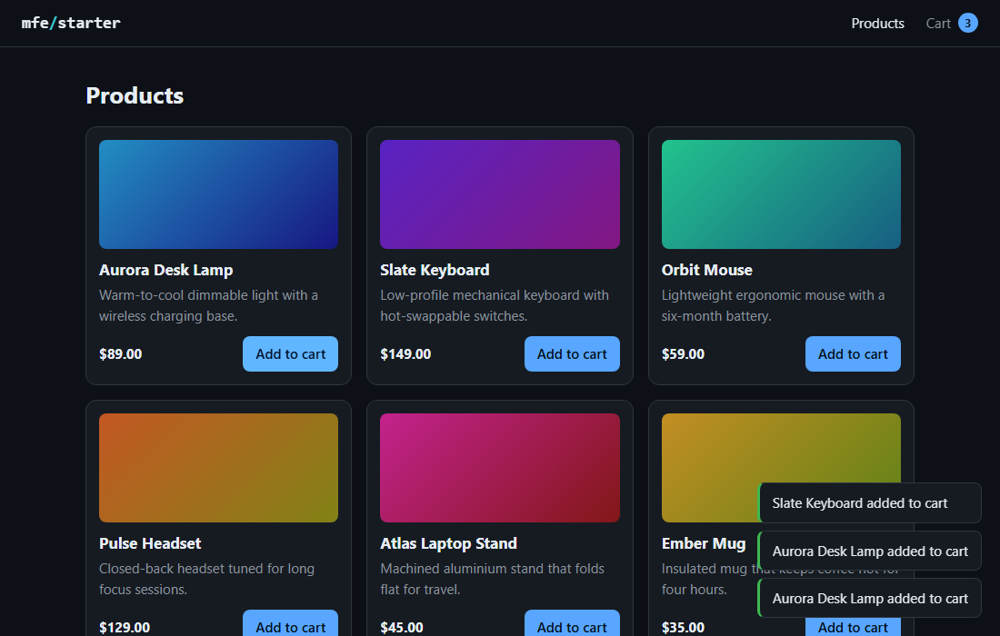
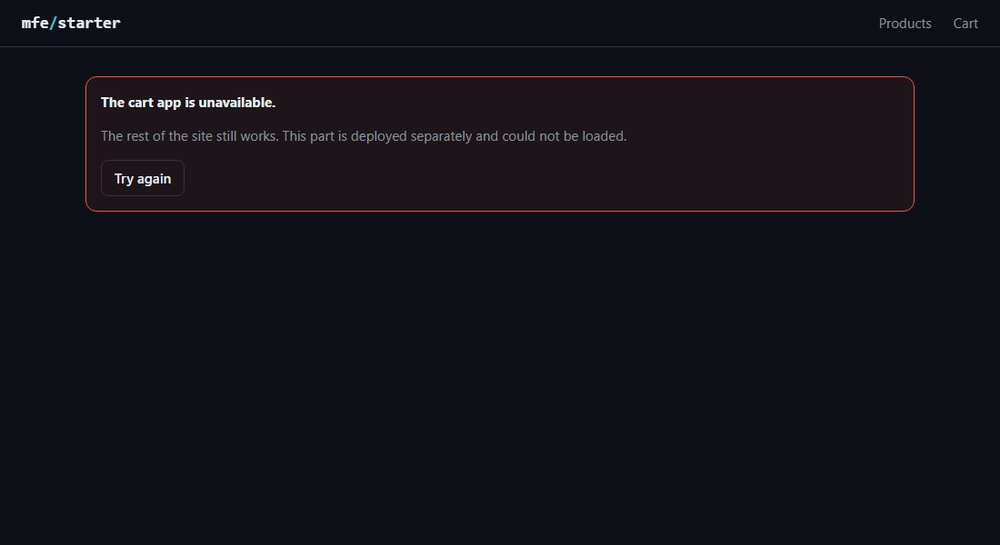
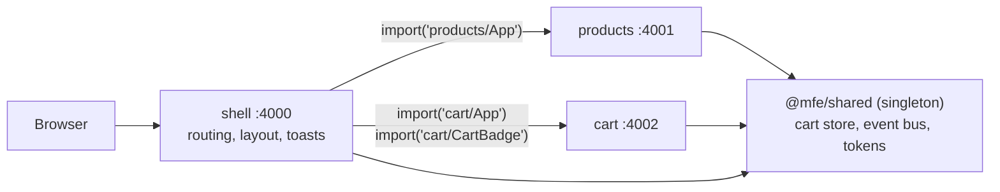

# mfe-starter

A working micro-frontend starter: one **shell** and two independently built **remotes** (products and cart), composed in the browser at runtime with Webpack 5 Module Federation. React 19, TypeScript, npm workspaces.



## Why micro-frontends

In a single front-end monolith, one team's change can block every other team's release. Here each app has its own build, its own deploy and its own dev server. The shell loads them on demand, so teams ship on their own schedule.

## What this demonstrates

- **Runtime composition.** The shell never bundles the remotes. It fetches `remoteEntry.js` from each deployment when a route needs it.
- **Failure isolation.** If a remote is down, only its region shows an error with a retry button. The shell and the other remotes keep working.

  

- **Shared singletons.** React, React Router and `@mfe/shared` are loaded once and shared, so hooks work and the cart state is not duplicated.
- **Decoupled communication.** Remotes never import each other. They use a shared cart store and a typed event bus (for example, products fire a toast the shell displays).
- **Standalone mode.** Every remote also runs by itself (`localhost:4001`, `localhost:4002`) so a team can develop without the shell.
- **Per-environment remote URLs.** Set `PRODUCTS_URL` and `CART_URL` when building the shell to point it at staging or production deployments.
- **A remote exposing a component, not just a page.** The cart team owns the cart badge in the shell header.

## Architecture



| Package | Role |
|---|---|
| `apps/shell` | The host. Owns routing, the header and the toast area. Wraps each remote in an error boundary. |
| `apps/products` | Remote. Exposes `./App` (product list and detail). |
| `apps/cart` | Remote. Exposes `./App` (cart page) and `./CartBadge` (header widget). |
| `packages/shared` | Framework-light shared code: typed event bus, cart store, design tokens. Tested with Vitest. |
| `tools/webpack.base.js` | One config factory, so the Module Federation wiring exists in a single place. |

## Run it

```bash
npm install
npm run dev
```

Open http://localhost:4000. Add some products, then open the cart.

To see failure isolation, stop only the cart dev server and reload: the cart region shows an error while products still work.

Other scripts: `npm run typecheck`, `npm test`, `npm run build`.

## Deploying

Each app builds to its own `dist/` and can be deployed to any static host independently. Build the shell last, with the real remote URLs:

```bash
PRODUCTS_URL=https://products.example.com CART_URL=https://cart.example.com npm run build -w @mfe/shell
```

Remote hosts must send `Access-Control-Allow-Origin` for the shell's origin.

## Trade-offs

Micro-frontends are not free. This starter makes these choices:

- **Shared state lives in a shared package.** That keeps the example small, but it couples the apps to one library's API. Prefer events or URL state for loosely related apps.
- **Versions are pinned loosely** (`requiredVersion: false`) for readability. In production, set real version ranges so a remote built against an incompatible React fails loudly.
- **Remote URLs are fixed at build time.** For independent releases without rebuilding the shell, resolve them at runtime from a manifest (the next step to add).
- **Type safety across remotes** is declared by hand in `apps/shell/src/remotes.d.ts`. Generating types from the remotes would remove that.

## Stack

React 19 · TypeScript · Webpack 5 Module Federation · React Router 7 · SWC · Vitest · npm workspaces · GitHub Actions

## License

MIT
